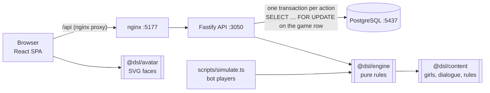

# Architecture

Dating Sim Lab is a small monorepo (npm workspaces). The game rules live in one pure TypeScript package that the API, the simulator and the tests all share. There's no AI and no network calls in the game logic: every line of dialogue is written by hand, and a deterministic rules engine picks and scores it.



## Packages

| Package | What it does | I/O |
|---|---|---|
| `packages/content` | The 5 hand-written girls, every dialogue pool, the mood × style table, balance knobs, and a seeded generator for girls 6–100 | none |
| `packages/engine` | `newGame`, `startConversation`, `reply`, `apologize`, `nextDay`, missions, scoring. Pure functions: state in, new state out | none |
| `packages/avatar` | `renderFace(spec, expression)` → SVG string. Six expressions; the web app renders faces itself | none |
| `apps/api` | Fastify 5 + `pg`. Loads a game, runs one engine function, saves it, all in one transaction | PostgreSQL |
| `apps/web` | React 19 + Vite SPA, built and served by nginx in its container | HTTP |

## How a reply is scored

```
delta = styleScale × (tasteWeight × her style weight + moodWeight × mood modifier[style])
      + topic bonus/penalty   (the fact value you reveal is in her likes / dislikes)
      + consistency bonus      (you repeat what you told HER before)
      − contradiction          (you tell HER something different from before)
      + memory hit             (you bring up something SHE told you)
      − memory mix-up          (you bring up something ANOTHER girl told you)
      + gift hit / − wrong gift (birthday)
      − early flirt            (flirting before she likes you)
      ± 1 noise
```

Gains shrink as affinity rises (`× (1 − affinity / damping)`), so getting to a crush takes several good conversations. After she unblocks you, losses count 1.5× until she's back to neutral. All the knobs are in `packages/content/src/rules.ts` (`BALANCE`) and were tuned with the simulator.

## Memory isolation

Each `GirlState` holds its own `memory: { heToldMe, iToldHim }`. The conversation code for girl A only reads A's state. In PostgreSQL the memory table's primary key is `(game_id, girl_id, kind, key)`, and loading puts each row into its own girl's object. So telling Maya you're a pilot and Noa you're a teacher is fine, but telling Maya two different jobs is a contradiction.

What the **player** learned from other girls is used in exactly one place: to offer a tempting "mix-up" reply (asking Lia about Maya's cat). She doesn't recognise it, and it costs affinity.

## Server authority

The browser never sees scores before it picks: `publicOptions()` strips `ref.correct` and `gift.correct`. The API is the only writer of game state. Each action runs in one transaction that locks the game row (`FOR UPDATE`), and a partial unique index (`conversations (game_id) WHERE status = 'active'`) means a game can never have two open conversations, even with two tabs clicking at once.

## Determinism

Every random choice (moods, which lines she says, option order, noise, apology acceptance) comes from a seeded PRNG keyed by `(game seed, day, girl, turn, purpose)`. The same seed and the same choices replay exactly, which makes the engine easy to test and the simulator meaningful.

## Data model

| Table | Holds |
|---|---|
| `players` | accounts (scrypt-hashed passwords; demo accounts also keep their demo password to show on the login page) |
| `games` | day, energy, mission points, status per game |
| `girl_states` | affinity, mood, blocked, careful, recent lines: one row per girl per game |
| `girl_memories` | `he_told_me` / `i_told_him` facts, one row per girl per fact |
| `missions` | daily and weekly missions with status |
| `conversations` | the live conversation state (JSONB) plus totals |
| `conversation_turns` | every turn: her lines, your reply, style, delta, reaction |
| `scores` | final score per finished game (leaderboard) |
