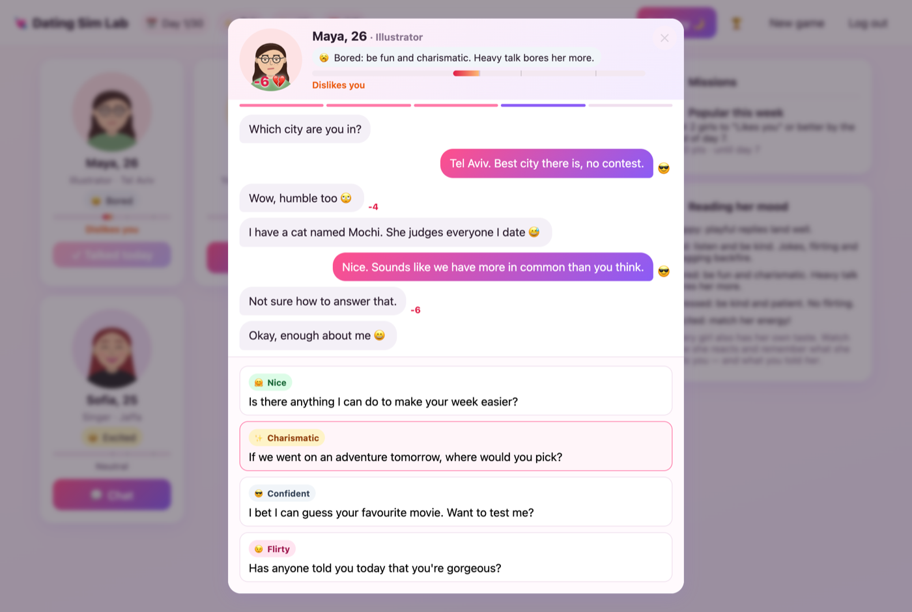
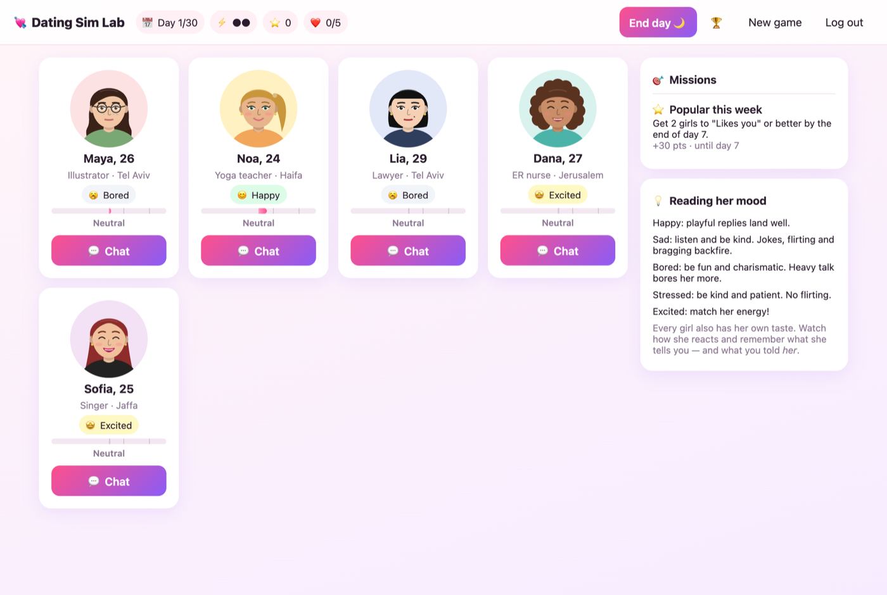
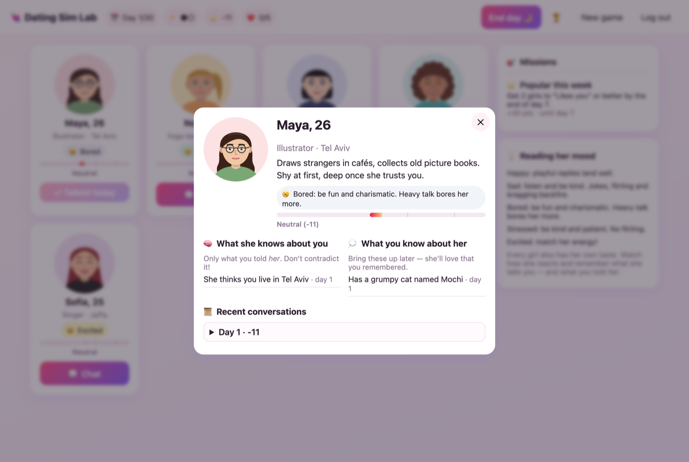
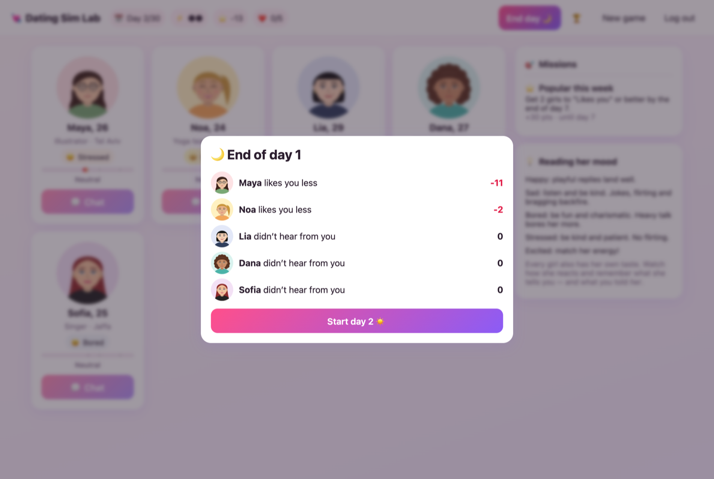
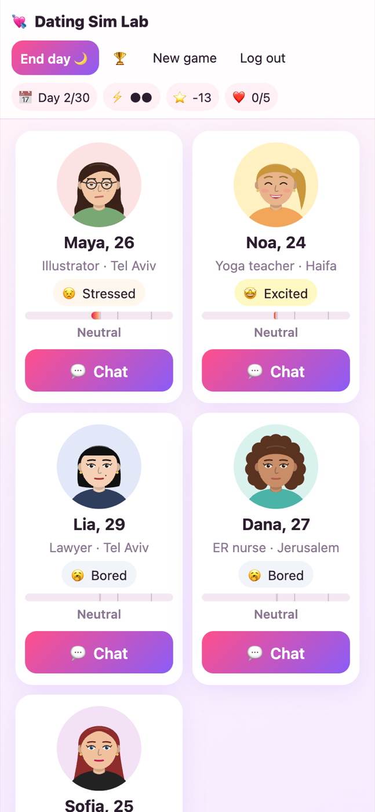
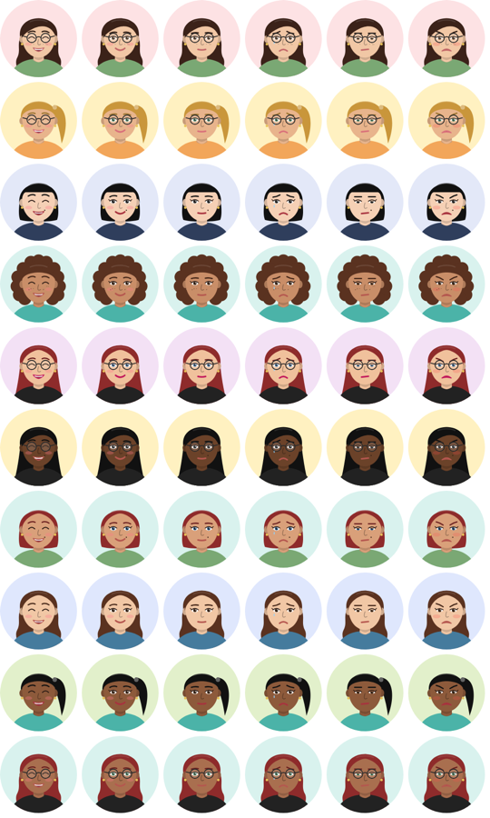
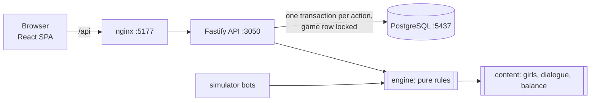

# Dating Sim Lab

[](https://github.com/allimist/dating-sim-lab/actions/workflows/ci.yml)


[](LICENSE)



A virtual dating game. You chat with virtual matches (5 to start, built to scale to 100). Each one has her own face, personality, daily mood and **her own memory of you**. Every turn you choose *how* to answer: 🤗 Nice, ✨ Charismatic, 😂 Funny, 😉 Flirty, 💭 Deep listener or 😎 Confident. The same line that makes one girl laugh makes another one block you, and a joke that works when she's bored backfires when she's sad.

There's **no AI and no API key**. Every line is written by hand and run by a deterministic rules engine, so it plays the same on any machine and the logic is fully testable. It's a learning project in the same spirit as [`hotel-booking-lab`](https://github.com/allimist/hotel-booking-lab) and [`flight-booking-lab`](https://github.com/allimist/flight-booking-lab): small enough to read in an afternoon, with the interesting parts left in.

## Table of contents

- [Play it](#play-it)
- [How to play](#how-to-play)
- [Faces](#faces)
- [Measured](#measured)
- [Architecture](#architecture)
- [Develop](#develop)
- [Notes](#notes)

## Play it

```bash
podman compose up --build -d     # or: docker compose up --build -d
```

Then open **http://localhost:5177** and click a demo account (`demo@example.com` / `demo123`), or sign up.

Everything runs in containers: PostgreSQL, the API and the web app (nginx). Nothing is installed on the host.

| What | Where |
|---|---|
| Game | http://localhost:5177 |
| API | http://localhost:3050/api/health |
| PostgreSQL | `localhost:5437`, user / password / db `dating` |

After changing code, rebuild and recreate (podman-compose does not recreate on image change by itself):

```bash
podman compose up --build -d --force-recreate --no-deps api web
```

## How to play

- **30 days, 2 conversations a day.** You pick who to talk to. A girl you ignore cools down, and after 3 days she feels ignored.
- **Read her mood** (😊 happy, 😢 sad, 🥱 bored, 😣 stressed, 🤩 excited). A sad girl wants to be heard; a bored one wants fun; never flirt with a stressed girl.
- **Learn her taste.** Lia (the lawyer) loves charisma and confidence. Dana (the nurse) can't stand arrogance. Sofia (the singer) loves flirting. Maya (the shy illustrator) wants a deep listener.
- **Remember her stories.** Later you can ask about Maya's cat Mochi, and she loves that you remembered. Ask *Lia* about Mochi and she'll ask who you're mixing her up with.
- **Keep your story straight with each girl.** Each one remembers only what you told *her*. You can tell Maya you're a pilot and Noa you're a teacher, but if you tell Maya you're a chef next week, she'll call you out.
- **Missions:** "Dana is sad today, cheer her up", "It's Noa's birthday, give her the gift she loves", "Lia blocked you, win her back", "Get 3 girls to like you this week".
- **Blocked:** drop to −60 and she walks out mid-chat and blocks you. You can send an apology every few days; if she accepts, you start again at −40 and every mistake hurts 1.5× until you're back to neutral.
- **Score** = sum of affinity + mission points + 50 per crush, plus a big bonus for a **perfect run** (every girl has a crush on you), which also ends the game early.

| | |
|---|---|
|  |  |
|  |  |

## Faces

Every face is drawn in code (`packages/avatar`): skin, hair style and colour, bangs, eyes, lips, glasses, earrings and freckles come from a seed, and there are six expressions that change live as she reacts. No image assets, and 100 unique faces from the generator.



## Measured

`npm run simulate -- 1000` plays 1,000 seeded games for each bot strategy through the real engine:

| Strategy | Avg score | Avg crushes (of 5) | Avg likes+ | Avg blocked | Perfect runs |
|---|---:|---:|---:|---:|---:|
| always nice | 222 | 0.29 | 2.53 | 0.83 | 0.0% |
| always charismatic | 339 | 0.79 | 2.97 | 0.21 | 0.0% |
| always funny | 450 | 0.47 | 3.77 | 0.01 | 0.0% |
| always flirty | -103 | 0.29 | 0.94 | 2.32 | 0.0% |
| always deep | 268 | 0.42 | 2.55 | 0.53 | 0.0% |
| always confident | -33 | 0.04 | 1.45 | 1.60 | 0.0% |
| random | 167 | 0.01 | 1.50 | 0.20 | 0.0% |
| mood-aware | 1070 | 3.40 | 4.99 | 0.00 | 46.6% |
| adaptive (mood + taste + memory) | 1228 | 5.00 | 5.00 | 0.00 | 100.0% |

- **Single-style bots never get a perfect run.** Always being nice, or always funny, gets some girls to like you, but the girls who hate that style drag the score down. CI fails if any single-style bot wins more than 5% of games.
- **Reading the mood alone** (the public hints) gets you about halfway: 3.4 crushes on average and a perfect run in 47% of games.
- **Mood + learning each girl's taste + memory** (a bot that learns from her reactions, keeps its story straight with each girl and never mixes them up) wins every time. That is the skill the game is about.

End to end through nginx → API → PostgreSQL on a laptop with Podman (`npm run e2e` plays a full 30-day game over HTTP): a reply takes **p50 ≈ 9 ms, p95 ≈ 17 ms**, and a whole game (~66 conversations, 330 replies) takes about 4 s.

## Architecture



- **The engine is pure.** State in, new state out, with a seeded PRNG for every random choice. The API, the simulator and the tests all run the same code.
- **The server is the authority.** Options sent to the browser carry no scoring hints (which memory or gift is the right one stays on the server). Each action is one PostgreSQL transaction with the game row locked, and a partial unique index keeps a game to one open conversation, even with two tabs open.
- **Memories are per girl** in code (`GirlState.memory`) and in the database (`girl_memories` is keyed by `game_id, girl_id`).

More in [ARCHITECTURE.md](ARCHITECTURE.md).

| Layer | Choice |
|---|---|
| Rules engine | TypeScript, no dependencies, deterministic |
| API | Node.js 22, Fastify 5, `pg`, JWT |
| Web | React 19, Vite 8, nginx |
| Database | PostgreSQL 16 |
| Containers | Podman Compose / Docker Compose |

## Develop

```bash
npm install
npm test                  # engine + avatar unit tests
npm run typecheck
npm run validate-content  # every mood × style × topic has lines, 100 generated girls are valid
npm run simulate          # balance report (add --ci to enforce it)
npm run e2e               # full game through the running stack
```

Add a girl by appending to `packages/content/src/girls.ts` (personality weights, likes, facts she can share, birthday, favourite gift, a few lines in her own voice), or start a game with a bigger cast: `POST /api/game/new {"castSize": 20}` uses the seeded generator for girls 6–100.

## Notes

All characters are fictional adults (21+). The content is PG-13. This is a learning project; nothing is production-ready on purpose (the demo passwords are shown on the login page).
